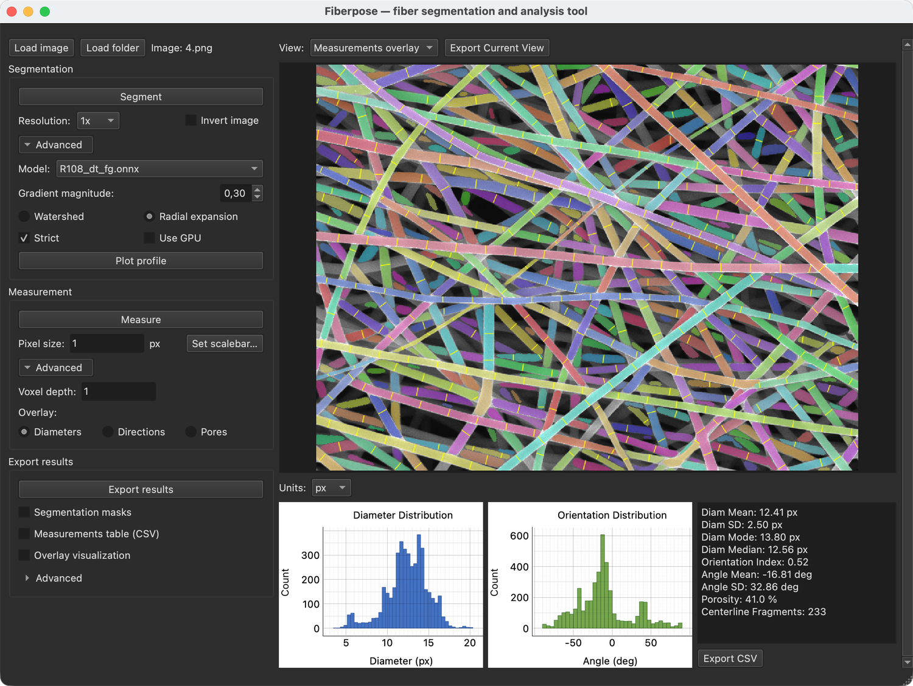

# Fiberpose

**Fiberpose** is a research software package for segmentation and quantitative morphometry of fibrous microstructures. Instead of relying on threshold-based binarization, Fiberpose predicts a neural distance-transform field from microscopy images and uses it as a geometric representation for centerline extraction, instance segmentation, diameter measurement, orientation analysis, and pore statistics.

It is designed for fibrous materials where conventional thresholding becomes fragile: dense networks, weak contrast, uneven illumination, touching fibers, and overlapping structures.



**Try it in the browser:** [Fiberpose on Hugging Face Spaces](https://huggingface.co/spaces/vikba/fiberpose) — no installation needed.

> Status: research-preview software under active development. Validate outputs on your own data before using them for publication or production decisions.

---

## Key features

- **Neural distance-transform prediction** from raw microscopy images.
- **Fiber centerline extraction** using ridge detection on the predicted distance-transform field.
- **Instance segmentation** of fiber fragments using marker-controlled watershed or radial expansion modes.
- **Morphometric analysis** of fiber diameter, orientation, orientation index, porosity, and pore-size distributions.
- **Interactive desktop GUI** for loading images, inspecting intermediate maps, adjusting parameters, visualizing overlays, and exporting results.
- **Batch-oriented CLI** for reproducible processing of folders and image stacks.
- **Publication-oriented exports**: distance-transform maps, labels, overlays, diameter/orientation overlays, measurement tables, summaries, and manifests.

---

## Method overview

Fiberpose follows a simple geometric pipeline:

1. A neural network predicts a continuous distance-transform field from the input image.
2. Centerlines are extracted as ridges of this field.
3. Fiber instances are separated using centerline markers and distance-transform geometry.
4. Measurements are sampled along centerlines:
   - local radius is one pixel plus the mean distance-transform value sampled one pixel away on each side,
   - local orientation is estimated from the distance field gradients,
   - pore sizes are estimated from the distance transform of the void space.

This makes the distance-transform field the central representation connecting neural inference, segmentation, and quantitative analysis.

---

## Installation

Fiberpose requires Python 3.10 or newer. A fresh conda or virtual environment is recommended.

```bash
git clone https://github.com/vikba/Fiberpose.git
cd Fiberpose

conda create -n fiberpose python=3.11 -y
conda activate fiberpose

pip install -e ".[gui]"
```

This installs Fiberpose in editable mode: changes to the code in `src/fiberpose/` take effect without reinstalling. Use `pip install -e .` (without `[gui]`) for the CLI and Python API only, without Qt dependencies.

### GPU note

Fiberpose runtime inference uses ONNX Runtime. GPU acceleration is available only if your installed ONNX Runtime build exposes `CUDAExecutionProvider`. If CUDA is unavailable, Fiberpose automatically falls back to CPU execution.

GPU inference needs an NVIDIA GPU with CUDA on Linux or Windows; it is not available on macOS. After installing Fiberpose, replace the CPU build of ONNX Runtime with the GPU build (the two cannot be installed side by side):

```bash
pip uninstall -y onnxruntime
pip install onnxruntime-gpu
```

Running `pip install -e .` again reinstalls the CPU build, so repeat these two commands afterwards.

---

## Pretrained model

The default model, `R108_dt_fg.onnx`, ships with the repository in `checkpoints/`, so a source checkout works offline. Fiberpose looks for models, by file name, in this order:

1. the folder set in the `FIBERPOSE_MODELS_DIR` environment variable;
2. `checkpoints/` in the repository, when running from a source checkout;
3. the per-user cache (for example `~/Library/Caches/fiberpose/models` on macOS).

To use your own ONNX model, place it in one of these folders and select it in the GUI, or set `model_path` in the configuration to its file name or absolute path.

---

## Running Fiberpose

The `fiberpose` command launches both GUI and CLI modes. `python -m fiberpose` is equivalent.

### GUI mode

```bash
fiberpose
```

or explicitly:

```bash
fiberpose --gui
```

The GUI supports:

- single image, folder, and stack loading;
- raw image, distance-transform, gradient-magnitude, Laplacian, centerline, segmentation, overlay, pore, diameter, and orientation views;
- model selection and CPU/GPU toggle;
- scalebar calibration;
- DT profile plotting;
- batch processing;
- export of masks, overlays, and CSV tables.

### CLI mode

Run segmentation on an image, folder, or stack:

```bash
fiberpose --cli --input /path/to/image_or_folder_or_stack
```

Run the full measurement pipeline:

```bash
fiberpose --cli --input /path/to/image_or_folder_or_stack --measurements
```

Write outputs to a selected directory:

```bash
fiberpose --cli --input /path/to/image_or_folder_or_stack --output /path/to/output
```

Use a custom config:

```bash
fiberpose --cli --input /path/to/image_or_folder_or_stack --config /path/to/config.json
```

Export only measurement CSV files:

```bash
fiberpose --cli --input /path/to/image_or_folder_or_stack --measurements --save-kind csv
```

### CLI arguments

| Argument | Description |
|---|---|
| `--gui` | Force GUI mode. |
| `--cli` | Run command-line processing mode. |
| `--input <path>` | Input image, folder, or stack. Required in CLI mode. |
| `--config <path>` | Path to a JSON configuration file. Default: the user configuration file (see Configuration below). |
| `--output <dir>` | Output directory for exported files. |
| `--measurements` | Run full measurement pipeline. Without this flag, CLI runs segmentation-only. |
| `--invert` | Invert image intensities before inference. Useful when fibers are dark on a bright background. |
| `--save-kind results\|csv` | Export full result artifacts or only CSV measurement tables. Default: `results`. |
| `--version` | Print the Fiberpose version and exit. |

### CLI exit codes

| Code | Meaning |
|---|---|
| `0` | Processing finished without failures. |
| `1` | Processing finished, but one or more frames failed during processing or export. |
| `2` | Invalid arguments, missing input/config/model, or startup/runtime error. |

### Web interface

A hosted version runs at <https://huggingface.co/spaces/vikba/fiberpose>. To run it locally, from the repository folder:

```bash
pip install -e ".[web]"
fiberpose --web            # http://localhost:7860
```

The same page runs in Docker (`docker build -t fiberpose . && docker run -p 7860:7860 fiberpose`)
and as a Hugging Face Gradio Space; `.github/workflows/deploy.yml` publishes both on a version tag.

### Python API

```python
import imageio.v3 as iio
import fiberpose

image = iio.imread("fibers.tif")
result = fiberpose.analyze(image, pixel_size=0.1, unit="um")

print(result.summary["diam_mean"], result.summary["orientation_index"])
result.labels               # instance labels (0 = background)
result.distance_transform   # predicted distance-transform field
result.diameters            # per-sample diameters in `unit`
```

Pass a `fiberpose.AppConfig` as the second argument to change model or analysis parameters.

---

## Supported inputs

Fiberpose can process common microscopy image formats, including:

```text
.tif, .tiff, .png, .jpg, .jpeg, .bmp, .webp
```

Folders are processed as batches. Multi-page TIFF files and image stacks are treated as stack inputs.

---

## Outputs

Depending on the selected export options, Fiberpose can save:

| Output | Description |
|---|---|
| `*_dt` | Predicted distance-transform map. |
| `*_labels` | Instance label visualization. |
| `*_overlay` | Segmentation overlay on the original image. |
| `*_diameters` | Diameter measurement overlay. |
| `*_orientations` | Orientation measurement overlay. |
| `*_outline` | Segmentation outline image. |
| `*_samples.csv` | Per-sample measurement table. |
| `*_summary.csv` | Batch-level summary table. |
| `manifest.json` | Export manifest with written files, skipped outputs, and errors. |

CSV exports include fiber diameter statistics, orientation metrics, porosity, and sample counts when the full measurement pipeline is enabled.

---

## Configuration

Your settings are stored in a per-user configuration file, created from the bundled defaults on first run:

| OS | Location |
|---|---|
| macOS | `~/Library/Application Support/fiberpose/config.json` |
| Linux | `~/.config/fiberpose/config.json` |
| Windows | `%LOCALAPPDATA%\fiberpose\config.json` |

The GUI saves its settings there when it closes. Delete the file to restore the defaults.

The configuration controls model path, device preference, image scaling, ridge detection parameters, segmentation mode, centerline filtering, measurement spacing, and export options.

You can edit configuration values in the GUI through the configuration editor or pass a config file directly to the CLI:

```bash
fiberpose --cli --input /path/to/data --config /path/to/config.json
```

---

## Project structure

```text
Fiberpose/
├── pyproject.toml             # Package metadata, dependencies, `fiberpose` command
├── README.md
├── PIPELINE.md                # Runtime pipeline details
├── LICENSE
├── app.py                     # Entry point of the Hugging Face Space
├── requirements.txt           # Dependencies of the Hugging Face Space
├── Dockerfile                 # Web interface as a container
├── checkpoints/               # Pretrained model (R108_dt_fg.onnx)
├── docs/                      # README images
└── src/fiberpose/
    ├── cli.py                 # GUI/CLI/web launcher (`fiberpose` command)
    ├── api.py                 # Public Python API: analyze()
    ├── models.py              # Model lookup, download, and cache
    ├── paths.py               # Bundled resources and user config locations
    ├── web/                   # Gradio web interface (`fiberpose --web`)
    ├── gui/                   # PyQt desktop interface (`fiberpose --gui`)
    ├── cli_runner.py          # Batch CLI processing
    ├── pipeline.py            # Pipeline orchestration
    ├── analysis.py            # Stateless prediction, segmentation, and measurement functions
    ├── render.py              # Display/export images of a frame (overlays, views)
    ├── raster.py              # Vectorized disk rasterization helpers
    ├── ridge_detector.py      # Ridge/centerline detector
    ├── ml.py                  # ONNX Runtime inference wrapper
    ├── domain.py              # Data models and configuration
    ├── io_export.py           # Export services
    ├── utils.py               # Numeric and image helper functions
    └── resources/
        ├── config.json        # Default configuration
        ├── fiber_tool.ui      # Qt GUI layout
        └── test.png           # Example image
```

---

## Troubleshooting

### Model file not found

The default model is expected in `checkpoints/` of the source checkout. If Fiberpose runs from elsewhere, copy `R108_dt_fg.onnx` into a folder and point `FIBERPOSE_MODELS_DIR` at it. For a custom model, check that `model_path` in your configuration is a file name in the models folder or an absolute path.

### GPU is not used

Confirm that ONNX Runtime sees CUDA:

```python
import onnxruntime as ort
print(ort.get_available_providers())
```

If `CUDAExecutionProvider` is missing, install the correct ONNX Runtime GPU package for your platform.

### Segmentation is inverted or poor

Try the `--invert` CLI flag or the invert option in the GUI if your fibers are dark on a bright background.

### Measurements are missing

Run the full analysis pipeline, not segmentation-only:

```bash
fiberpose --cli --input /path/to/data --measurements
```

---

## Citation

If you use Fiberpose in scientific work, please cite the associated manuscript/preprint when available.

```bibtex
@software{fiberpose,
  title  = {Fiberpose: A deep learning framework for segmentation and quantitative analysis of fibrous structures},
  author = {Balashov, Viktor},
  year   = {2026},
  url    = {https://github.com/vikba/Fiberpose}
}
```

---

## License

Fiberpose is free software licensed under the GNU General Public License,
version 3 only (`GPL-3.0-only`). See `LICENSE` for details.

---

## Disclaimer

Fiberpose is research software for microscopy image analysis. It is not a medical device and should not be used for clinical diagnosis or treatment decisions.
